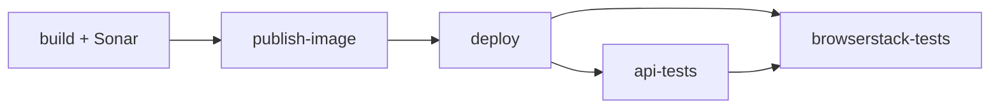

# Discord message sender/receiver

[](https://github.com/<your-username>/discord_sender/actions/workflows/ci.yml)

A Java 21 Spring Boot application that sends messages to Discord through a webhook and reads
recent channel messages with a [JDA](https://github.com/discord-jda/JDA) bot. One server provides
both the bundled web client and the HTTP API.

The project is an older personal project, refactored to practice CI/CD: automated tests,
static analysis, container publishing, cloud deployment and post-deployment checks.

## Quick start

```bash
# Docker
docker compose up --build

# Or locally (Windows: .\gradlew.bat bootRun)
./gradlew bootRun
```

The server listens on port 8080. Open <http://localhost:8080> for the web client.

## Configuration

| Variable              | Required               | Purpose                                |
| --------------------- | ---------------------- | -------------------------------------- |
| `DISCORD_BOT_TOKEN`   | Yes                    | Discord bot token (receiving messages) |
| `DISCORD_WEBHOOK_URL` | When sending a webhook | Discord incoming webhook URL.          |

The bot needs the `MESSAGE_CONTENT` and `GUILD_MESSAGES` intents enabled in the Discord
Developer Portal.

## HTTP API

| Endpoint              | Description                                                     |
| --------------------- | --------------------------------------------------------------- |
| `POST /webhook/send`  | Send `{"message":"..."}` (non-blank, max 2000 characters).      |
| `GET /webhook/config` | Returns `{"configured": true/false}`. The URL is never exposed. |
| `GET /bot/messages`   | Returns the bot's recent message history.                       |

```bash
curl -i -X POST http://localhost:8080/webhook/send \
  -H "Content-Type: application/json" -d '{"message":"Hello Discord"}'
```

### Responses for `POST /webhook/send`

| Status | Meaning                                            |
| ------ | -------------------------------------------------- |
| `204`  | Message sent, empty body.                          |
| `400`  | Invalid or malformed request.                      |
| `502`  | Discord returned an error (including rate limits). |
| `503`  | Webhook URL is not configured.                     |
| `504`  | Discord unreachable or timed out.                  |

`RestClient` throws on 4xx/5xx automatically, and a central `@RestControllerAdvice` maps those
exceptions to the statuses above. Error bodies are generic and logs record only the exception
class, because exception messages can contain the webhook URL.

## Testing

| Layer         | Tooling                              | Covers                                      |
| ------------- | ------------------------------------ | ------------------------------------------- |
| Controller    | JUnit 5, `@WebMvcTest`, MockMvc      | Status codes, validation, error mapping.    |
| Service       | `MockRestServiceServer`, AssertJ     | Outbound requests and failures, no network. |
| API           | Postman collection run by Newman     | Public endpoints of the deployed app.       |
| Browser (e2e) | Selenium on BrowserStack (`e2e` tag) | The web client in real browsers.            |

```bash
./gradlew test       # unit and slice tests
./gradlew e2eTest    # BrowserStack tests (needs credentials)
```

## CI/CD pipeline

`.github/workflows/ci.yml` runs on pushes to `main` and on pull requests (PRs run only `build`).



| Job                  | What it does                                                              |
| -------------------- | ------------------------------------------------------------------------- |
| `build`              | Builds and tests with Gradle, uploads reports, runs SonarQube.            |
| `publish-image`      | Pushes the Docker image to GHCR, tagged `latest` and with the commit SHA. |
| `deploy`             | Logs in to Azure via OIDC and deploys the SHA-tagged image.               |
| `api-tests`          | Waits for the app, then runs the Newman collection.                       |
| `browserstack-tests` | Runs the Selenium regression suite against the deployed app.              |

```yaml
- uses: gradle/actions/setup-gradle@<full-commit-sha> # v6.x.y
```

## Deployment

The app runs on Azure Container Apps, pulling `ghcr.io/<your-username>/discord_sender`.
GitHub authenticates to Azure with OpenID Connect through a user-assigned managed identity
(federated credential for the `main` branch), so no client secret is stored. The Discord bot
token and webhook URL are set as secrets on the Container App itself, not in GitHub.

GHCR packages are private by default. If the deploy cannot pull the image, make the package
public or supply registry credentials.

## Security notes, future concerns

- The API is unathenticated, may add authentication or rate limiting later
- User text like `@everyone` can ping a server. Consider `"allowed_mentions": {"parse": []}`
  in the webhook payload.
